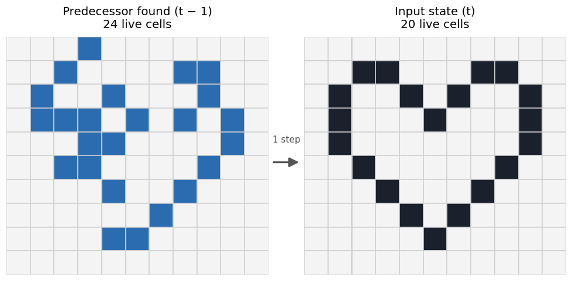

# Reverse Game of Life with MaxSAT

Given a state of [Conway's Game of Life](https://en.wikipedia.org/wiki/Conway%27s_Game_of_Life), this program finds a **previous state** that produces it in one step, and among all valid predecessors it looks for the one with the **fewest live cells**. Running the Game of Life backwards has no direct formula, so the problem is encoded as **weighted CNF** and solved with the MaxSAT solver [Open-WBO](https://github.com/sat-group/open-wbo).

<p align="center">
  
</p>

## How it works

### 1. Encoding

Each cell of the board is a Boolean variable that is true if the cell is **alive in the previous state**. For every cell, the program writes clauses that force the previous state to evolve into the given one. The rules come from S. Bain's *Time-Reversal in Conway's Life as SAT* (2007), adapted to MaxSAT:

| Cell in the given state | Rule | What the clauses forbid in the previous state |
|---|---|---|
| Alive | Loneliness | Fewer than 2 live neighbors |
| Alive | Stagnation | A dead cell with exactly 2 live neighbors |
| Alive | Overcrowding | More than 3 live neighbors |
| Dead | Preservation | A live cell with exactly 2 live neighbors |
| Dead | Life | Any cell with exactly 3 live neighbors |

The clauses are produced by recursively enumerating subsets of each cell's neighbors. Border and corner cells have fewer neighbors and get their own generators.

### 2. Optimization

- The clauses above are **hard** (weight 10), so any solution must satisfy them.
- One **soft** clause `¬cell` (weight 1) per cell makes the solver prefer predecessors with **fewer live cells**.

### 3. Solving

The formula is written to `solution/clauses.wcnf` and Open-WBO is called with a 5-minute limit. It returns the optimum, reports UNSAT (the pattern is a [Garden of Eden](https://en.wikipedia.org/wiki/Garden_of_Eden_(cellular_automaton)), which has no predecessor) or, when time runs out, the best solution found so far. Then the assignment is decoded back into a board.

A first approach with a plain SAT solver is also implemented (`findBestSolution`). It finds any solution, adds its negation as a new clause and repeats until no better one exists. It was much slower than MaxSAT, especially on boards larger than 15×15.

## Usage

```bash
make
./goingBack input.txt
./goingBack -verify examples/heart.txt   # also simulates one step and checks every cell
```

The input file gives the board size followed by the cells (`1` = alive). The outermost ring of the board must be dead, and cells outside the board count as dead.

```text
4 6
0 0 0 0 0 0
0 0 1 1 0 0
0 0 0 1 1 0
0 0 0 0 0 0
```

The predecessor is printed in the terminal. The generated formula goes to `solution/clauses.wcnf` and the solver's answer to `solution/solution.txt`.

> The `open-wbo` binary in this repository is built for Linux x86-64. On other systems, build it from the [Open-WBO source](https://github.com/sat-group/open-wbo) and place the executable in the project root.

## Project structure

```text
src/
├── goingBack.c   # entry point: reads the input, builds the formula, calls the solver
├── clauses.c     # clause generation for each Game of Life rule
├── test.c        # one-step simulation and cell-by-cell verification
└── utils.c       # I/O, neighbor lookup, solution parsing, SAT-only search
include/          # headers
examples/         # sample inputs
```